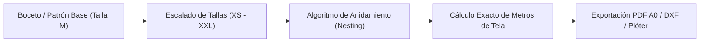

# 🚀 Propuesta de Valor y Roadmap de Funcionalidades para SewStudio

> [!NOTE]
> **SewStudio** tiene el potencial de convertirse en la plataforma SaaS estándar para modistas, diseñadoras de moda, patronistas y talleres textiles pequeños y medianos. A continuación se detallan todas las mejoras y funcionalidades estratégicas clasificadas por áreas funcionales.

---

## 📐 1. Ficha de Clientes & CRM Textil (Toma de Medidas)

> [!IMPORTANT]
> Una de las necesidades más críticas en confección a medida es llevar un registro preciso de los clientes y sus medidas anatómicas.

### Funcionalidades a Agregar:
* **Ficha de Medidas Anatómicas Personalizada:**
  * Registro de más de 20 medidas corporales (Contorno de Busto, Cintura, Cadera, Talle Delantero, Talle Espalda, Largo de Manga, Ancho de Hombro, Tiro, Altura de Cadera, etc.).
  * Historial de cambios de medidas del cliente en el tiempo.
  * Silueta humana interactiva para hacer clic sobre una zona del cuerpo y registrar la medida correspondiente.
* **Calendario de Pruebas de Calce (*Fit Sessions*):**
  * Agendamiento de citas para primera prueba, segunda prueba y entrega final.
  * Notificaciones recordatorias automáticas por **WhatsApp / Email** al cliente.
* **Presupuestos y Cotizaciones en PDF:**
  * Generación de presupuestos formales exportables en PDF para enviar al cliente antes de iniciar el proyecto.
  * Registro del estado de pago (Seña del 50%, Saldo pendiente a la entrega).

---

## ✂️ 2. Módulo de Patronaje Avanzado & Optimización de Tela

### Funcionalidades a Agregar:
* **Escalado Automático de Tallas (*Grading*):**
  * Permite definir reglas de escalado para transformar un patrón de Talla M a Tallas XS, S, L, XL y XXL ajustando automáticamente los puntos de control.
* **Optimización de Corte / Anidamiento (*Nesting*):**
  * Algoritmo que acomoda todas las piezas del patrón sobre un ancho de tela definido (ej: 1.40m o 1.50m) para **minimizar el desperdicio de tela** y calcular los metros exactos a comprar.
* **Exportación en Formatos de Corte e Impresión Profesional:**
  * Exportación en **PDF A0 en capas por talla** (para imprimir en plóter).
  * Exportación en formato industrial **DXF-AAMA** y **PLT** compatible con máquinas de corte láser y plóters de patronaje.

---

## 📊 3. Costeo Financiero & Amortización de Maquinaria

### Funcionalidades a Agregar:
* **Amortización de Maquinaria y Consumo Eléctrico:**
  * Inclusión del desgaste por hora de máquinas (Overlock, Recta, Collareta, Plancha industrial).
  * Cálculo proporcional de gastos fijos del taller (luz, alquiler, internet) repartidos entre las horas trabajadas.
* **Calculadora de Margen de Ganancia Comercial:**
  * Comparativa gráfica entre:
    * **Costo de Materiales + Mano de Obra**
    * **Precio Sugerido Venta Mayorista**
    * **Precio Sugerido Venta Minorista**
* **Control de Variaciones de Costo:**
  * Alerta si el costo real final superó el estimado inicial debido a insumos extra o más horas de trabajo.

---

## 🧵 4. Inventario Inteligente & Proveedores

### Funcionalidades a Agregar:
* **Lector de Código de Barras / QR:**
  * Posibilidad de escanear etiquetas fijadas a los rollos de tela o cajas de hilos con la cámara del celular para descontar/ingresar stock en segundos.
* **Conversor de Unidades & Mermas:**
  * Cálculo de mermas por lavado o encogimiento previo de telas (ej: lino o algodón que encoge un 5%).
* **Directorio y Calificación de Proveedores:**
  * Registro de proveedores habituales, precios históricos por metro de tela y notas de calidad.

---

## 🤖 5. Inteligencia Artificial para Diseño & Producción

### Funcionalidades a Agregar:
* **Generador de Figurines & Bocetos por IA:**
  * El usuario escribe una descripción (ej: *"Vestido de fiesta midi en satén verde con escote drapeado"*) y la IA genera figurines de moda ilustrados.
* **Analizador de Fotos para Desglose de Moldes:**
  * Subes una fotografía de una prenda y la IA:
    * Identifica el tipo de corte (princesa, imperio, acampanado).
    * Sugiere las piezas de patrón necesarias.
    * Recomienda las mejores telas según la estructura y caída deseada.

---

## 🌐 6. Catálogo Público, Reservas & PWA Móvil

### Funcionalidades a Agregar:
* **Pasarela de Cobro en el Catálogo Público:**
  * Integración con **MercadoPago / Stripe** para permitir a clientes encargar o reservar prendas del catálogo abonando una seña online.
* **Aplicación Web Progresiva (PWA):**
  * Permitir instalar SewStudio en el teléfono celular o tablet como si fuera una app nativa, con soporte para funcionar **offline en el taller** cuando no hay conexión.

---

## 🏆 Matriz de Priorización de Funcionalidades

| Funcionalidad | Módulo | Impacto | Esfuerzo | Prioridad |
| :--- | :--- | :---: | :---: | :---: |
| **Ficha de Clientes & Medidas Anatómicas** | CRM | 🔴 Alto | 🟢 Bajo | **Fase 1** |
| **Generador de Presupuestos en PDF** | CRM | 🔴 Alto | 🟢 Bajo | **Fase 1** |
| **Escalado de Tallas (Grading)** | Patronaje | 🔴 Alto | 🟡 Medio | **Fase 2** |
| **Optimización de Corte (Nesting)** | Patronaje | 🔴 Alto | 🔴 Alto | **Fase 2** |
| **Escáner QR para Inventario** | Inventario | 🟡 Medio | 🟢 Bajo | **Fase 2** |
| **Cálculo de Amortización de Máquinas** | Costeo | 🟡 Medio | 🟢 Bajo | **Fase 2** |
| **Generación de Figurines con IA** | IA | 🟡 Medio | 🟡 Medio | **Fase 3** |
| **Pagos en Catálogo Público (Stripe/MP)** | Catálogo | 🔴 Alto | 🟡 Medio | **Fase 3** |
